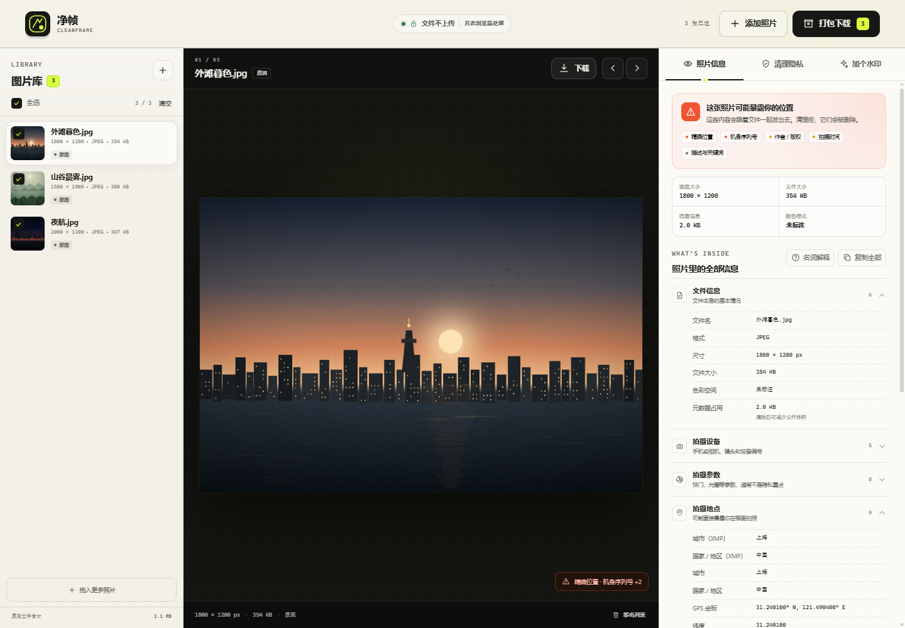
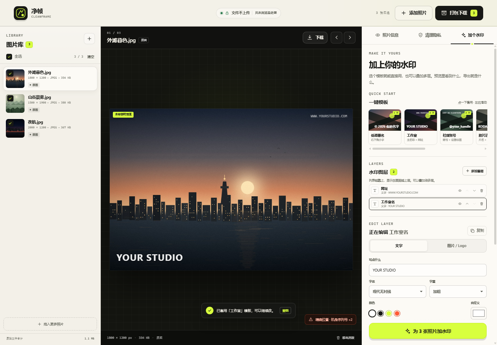
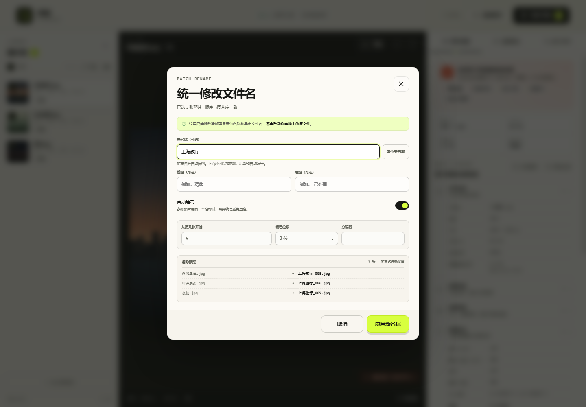
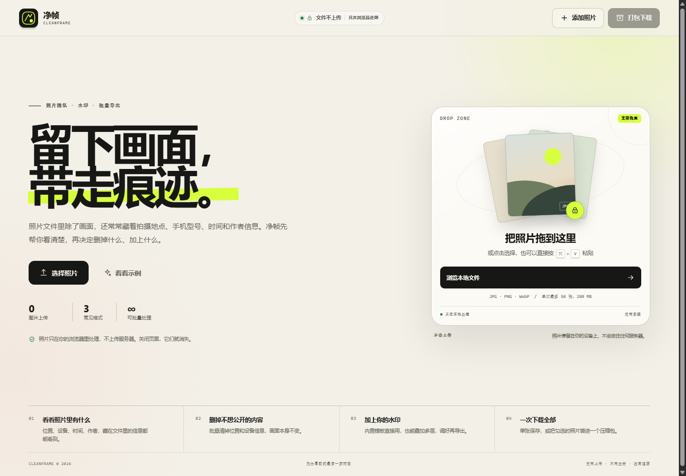
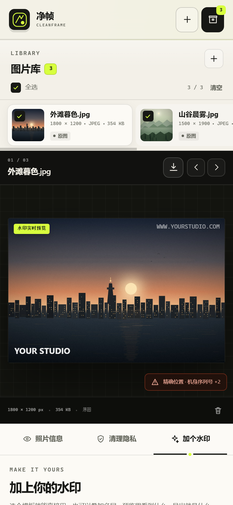

# 净帧 CLEANFRAME

> 留下画面，带走痕迹。

一个完全在浏览器本地运行的照片隐私与水印工作台：先看清照片里藏着的位置、设备、时间和作者，再批量清理、统一改名，最后用内置模板或多层自定义水印署名，单张下载或打包成 ZIP。

没有服务器上传，没有账号，没有构建步骤，也没有运行时依赖。







| 首页 | 移动端 |
| --- | --- |
|  |  |

## 启动

需要 Node.js 20 或更高版本。它只用于启动一个本地静态文件服务器，图片不会经过它。

```text
双击「启动网站.cmd」
```

或者：

```bash
node server.mjs --open
# 或
npm start
```

打开 <http://127.0.0.1:5173>。

也可以使用任意静态服务器托管此目录。**不要直接双击 `index.html`**：ES Modules 和本地示例图片在 `file://` 下会被浏览器拦截。

## 能做什么

### 1. 看见隐藏信息

- 读取 JPEG 的 EXIF、GPS、XMP、IPTC / Photoshop 字段、注释与 ICC 信息。
- 读取 PNG 的 `tEXt`、`zTXt`、`iTXt`、`eXIf`、`tIME`、`pHYs`。
- 读取 WebP 的 `EXIF`、`XMP `、`ICCP`。
- 自动标记精确位置、机身序列号、作者 / 版权、拍摄时间等字段。
- 字段按文件、相机、拍摄参数、位置、作者、描述、时间、软件、XMP、IPTC、技术分组，可逐项展开。
- 一键复制全部元数据文本。

### 2. 清理隐藏信息

- JPEG / PNG / WebP 优先进行**容器级剥离**，不改动像素数据，也不重新压缩。
- 默认保留 ICC 色彩配置，避免导出后颜色变化。
- 带 EXIF 旋转信息的 JPEG 会先自动转正，避免清理方向标记后照片横倒。
- 清理结果始终保留原图在内存中，可随时「恢复原图」或通过 Toast 撤销整批操作。
- 支持勾选图片后批量应用。

### 3. 内置模板与多层水印

- **7 个内置模板**：低调署名、工作室、社媒账号、胶片边注、防盗图、日期地点、品牌角标。
- 模板不是固定图片，而是生成一组可编辑图层：文字、大小、颜色、位置、透明度都能继续改。
- **多层叠加**：主标题、账号、日期可分别占一层；图层可新增、复制、隐藏、上移、下移、删除。
- 每个图层都可以独立选择文字或上传图片 / Logo，上传的 Logo 只作用于当前图层。
- 九宫格位置、边距、字号、标识大小、不透明度、颜色、字重、旋转、投影、整图平铺。
- 页面内实时预览；导出时按原分辨率在 `<canvas>` 上按图层顺序重新渲染。
- 图片输出格式可选自动 / JPEG / PNG / WebP，JPEG / WebP 可调质量。
- 水印输出本身不携带元数据；套用模板、删除图层都可以撤销。

### 4. 批量修改文件名

- 勾选多张照片后点「改名」，可以统一使用一个基础名称。
- 支持前缀、后缀、自动编号、起始编号、编号位数、分隔符，以及「用今天日期」。
- 自动编号默认在输入统一名称后开启；不会在打开对话框时立刻改掉原名。
- 实时预览「原名 → 新名」，重名、空名称会直接提示并禁用应用按钮。
- 扩展名自动保留，非法字符会自动替换，Windows 保留名会加前缀。
- 文件名会同步到图片库、预览区、照片信息、单张下载和 ZIP。
- 只修改净帧内的名称和导出文件名，**不会改动电脑上的原文件**；改完可以撤销。

### 5. 导出

- 下载当前显示的原图或处理结果。
- 按勾选状态打包 ZIP，已处理图片使用处理结果，未处理图片原样导出。
- ZIP 使用 UTF-8 文件名、Store（不压缩，图片本身已压缩），支持中文文件名。
- 导出文件名自动加 `-clean` / `-watermark` 后缀，避免覆盖原图。

## 隐私设计

- 所有解码、解析、清理、Canvas 渲染、ZIP 生成都在当前页面内完成。
- 运行时不请求任何外部服务；示例图片也在仓库内。
- 使用 LocalStorage 保存水印图层设置（文字、位置、透明度、图层顺序等）以及你主动上传的 Logo 数据；这些数据只留在本机浏览器，不会上传。
- 照片本身、照片预览、清理结果和导出文件不写入 LocalStorage。
- 关闭页面后，内存中的图片和处理结果随页面销毁。

## 支持与限制

| 项目 | 说明 |
| --- | --- |
| 导入格式 | JPG / JPEG / PNG / WebP |
| 单次数量 | 最多 50 张 |
| 单次总量 | 最多 200 MB |
| ZIP 总量 | 建议不超过 450 MB |
| 不含 | HEIC / AVIF / GIF / TIFF（建议先转为 JPEG 或 PNG） |
| 清理方式 | 非旋转图片保留原始压缩数据；带旋转信息的图片处理时重新编码以转正（JPEG 质量 0.95） |
| 水印方式 | 必然重新编码，质量默认 92%；支持多个图层叠加，数量取决于设备内存 |
| ICC | 默认保留嵌入的 ICC；关闭开关会移除。若因方向校正而重编码，色彩由浏览器解码到画布，无法保证原配置逐字节保留 |
| 体积提示 | 清理后通常变小；加水印后可能因重新编码而变大，界面不会虚报节省 |
| 测试环境 | Chrome 158 headless、Node 24；其余现代浏览器依赖 `createImageBitmap`、`DecompressionStream` 等 API |

## 目录

```text
cleanframe/
├─ index.html              页面结构、图标 sprite
├─ css/styles.css          设计系统与响应式布局
├─ js/app.js               状态、交互、批处理、导出
├─ js/metadata.js          JPEG / PNG / WebP 元数据解析与容器级清理
├─ js/watermark.js         Canvas 水印绘制、图层合成与全分辨率导出
├─ js/watermark-presets.js 7 个内置水印模板
├─ js/rename.js            批量改名规则、校验和名称预览
├─ js/zip.js               零依赖 ZIP32（Store）写入
├─ assets/samples/         三张带 EXIF / GPS / XMP / IPTC 的示例图
├─ assets/screenshots/     README 预览图
├─ tests/metadata.test.mjs 元数据、清理、ZIP 单元测试
├─ tests/watermark.test.mjs 图层、模板、可见性单元测试
├─ tests/rename.test.mjs   批量改名规则、扩展名、冲突校验测试
├─ tests/fixtures/         PNG / WebP / EXIF 旋转 / Logo 测试素材
├─ server.mjs              零依赖本地静态服务器
└─ 启动网站.cmd             Windows 一键启动
```

## 测试

```bash
npm test
```

等价于：

```bash
node tests/metadata.test.mjs && node tests/watermark.test.mjs && node tests/rename.test.mjs
```

测试覆盖：

- JPEG 相机、GPS、XMP、IPTC 解析。
- JPEG / PNG / WebP 元数据清除后再次解析为零。
- PNG `iTXt` 中文文本。
- EXIF Orientation 6 识别。
- CRC32、ZIP 本地头 / 中心目录、UTF-8 文件名、重复文件名去重。
- 水印图层顺序、显隐、类型、Logo 可见性；7 个内置模板的结构。
- 批量改名：统一名称、前后缀、自动编号、日期填充、重名阻止、扩展名保留。

浏览器端还做过以下人工与 CDP 渲染验证：

- 文件选择导入路径（通过 CDP 原生设置文件验证）与示例批量导入。
- 三格式批量清理；旋转 JPEG 输出为 480 × 640 且无 EXIF。
- 7 个内置模板均能套用并生成可编辑图层；叠加编辑、图层上移/下移、复制、隐藏、删除和撤销。
- 多层文字 + 独立 Logo 图层的预览与全分辨率导出。
- 水印图层与 Logo 刷新后从 LocalStorage 恢复。
- 单张下载与 ZIP 下载；ZIP 内所有文件 EXIF 为 0。
- 批量改名应用、撤销、ZIP 内文件名同步；移动端改名弹窗无横向溢出。
- 删除撤销、选择切换、桌面 / 390 px 移动端布局。
- 动态内容与移动端无可访问名称缺失的按钮或输入框。

## 说明

这是一个纯静态产品原型，没有持久化后端。刷新页面会丢失当前图片列表、批量修改后的文件名与处理结果；水印图层设置会保留。照片永远不会写入持久存储，这是本地隐私模型的自然结果，也是刻意的设计选择。

水印、清理、ZIP 均不依赖第三方库。这样文件不会离开设备，也便于审计。
